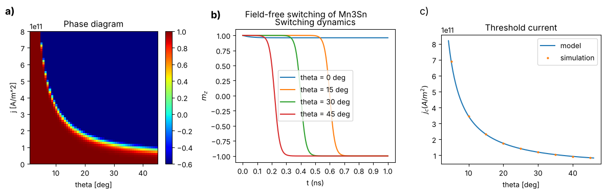
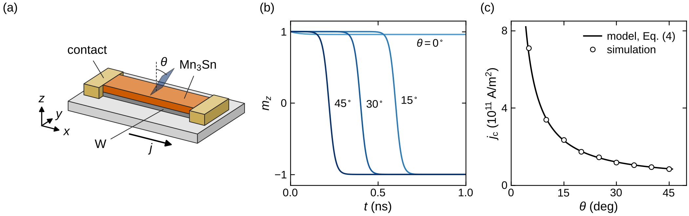

# complete-paper

[](https://github.com/gyuyoungpark/complete-paper/actions/workflows/tests.yml)
[](LICENSE)

**English** | [中文](README_zh.md) | [한국어](README_ko.md) | [日本語](README_ja.md)

**From research results to a finished paper whose title, abstract, figures and conclusion claim the same thing, with no number or citation invented on the way.**

complete-paper is an agent skill for researchers who write with Claude Code, Codex or another agent that reads `SKILL.md` folders. It covers every part of a paper, from the claim sheet to the submission package, one part at a time. Each part comes with its rules, the evidence behind them, and a script that checks your LaTeX files.

## What it does

**Figures.** A first draft, and the same figure rebuilt by the figures part (invented data). The draft has a title on every panel, a rainbow colour map, a legend lying on the curves, one colour with two meanings and units written two ways, and `fig_lint.py` lists each of these. The rebuilt figure is drawn at its printed width from one style table, and its schematic is drawn in code.





**Prose.** A paragraph before and after `parts/prose.md` (invented example). The machine tone goes because each sentence is asked what it claims, not because words are swapped.

> *Before.* It is worth noting that noncollinear antiferromagnets have attracted considerable attention in recent years, playing a pivotal role in next-generation spintronics. In this work, we performed a comprehensive investigation of the switching dynamics, which may potentially suggest a novel mechanism, highlighting the remarkable potential of tilted films. Overall, these findings pave the way for future memory applications.

> *After.* Switching a noncollinear antiferromagnet by current has so far required a magnetic field [A, B]. We simulated the reversal in films whose kagome plane is tilted, and found that the tilt replaces the field. The current alone sets the final state.

**Checks.** Part of the audit report on a short invented letter with planted faults:

```
$ cd tests/fixtures/flawed
$ python ../../../skills/complete-paper/scripts/audit.py main.tex
...
- main.tex:51: a to-do mark is left in the text: "\textcolor{red}{\textbf{[TODO: data for the thick-film case]}}"
- Abstract: quotes 45, which the rest of the text does not contain: the abstract may give no number that the body lacks
...
  main.tex:52  c: cited 1 time(s), but no such entry
  main.tex:44: Fig. 3 is never cited in the text
  text: Figs are first cited in the order 2, 1: number them in the order of first citation
  CRITICAL main.tex:8             question mark in the title; rewrite as a statement or an indirect question
...
- part checks that fail: equations, citations, references
```

## Install

**Any agent that supports skills** (Claude Code, Codex, Cursor and others), with the [skills CLI](https://github.com/vercel-labs/skills):

```bash
npx skills add gyuyoungpark/complete-paper
```

Add `-g` to install it for all your projects instead of the current one.

**Claude Code plugin**:

```
/plugin marketplace add gyuyoungpark/complete-paper
/plugin install complete-paper@complete-paper
```

Installed as a plugin, the skill is called as `/complete-paper:complete-paper`; installed with the skills CLI, as `/complete-paper`.

**Claude app**: download `complete-paper.skill` from [Releases](https://github.com/gyuyoungpark/complete-paper/releases) and upload it in the app's skill settings.

**Updating**: installs made with the skills CLI update with `npx skills update`. Plugin installs update with `/plugin marketplace update complete-paper`, or turn on auto-update for this marketplace under `/plugin`. In the Claude app, upload the `complete-paper.skill` of the new release.

Requirements: Python 3.9 or later. The figure scripts need matplotlib and numpy. `ref_check.py --online` needs network access. `submit_check.py` uses `pdflatex` and the poppler tools when they are installed. The scripts read LaTeX sources.

## First run

Open your agent in the folder of your manuscript and ask:

```
Use complete-paper to audit main.tex. Report what you find and do not edit.
```

In audit mode the skill reports and never edits, and it asks which findings to fix. Other good first requests:

- "Start the brief for this paper with complete-paper." The brief is the claim sheet that every other part writes from.
- "Write the abstract with complete-paper."
- "Check my references online with complete-paper." Every entry is compared with its Crossref or arXiv record.

There is nothing to sign up for and no API key. The skill keeps its working files in a `paper-state/` folder next to your manuscript, so a later session continues where the last one stopped.

## What is different

- **One claim sheet for the whole paper.** `brief.md` records the result, the system, the kind of evidence and what the paper does not show. Title, abstract, captions and conclusion are all written from it, so they cannot claim different things, and none can claim more than the figures show.
- **Every rule says where it comes from.** Each part has an evidence file that separates journal rules, published studies, what was measured while building the skill, and the skill's own choices. Where studies disagree, it says so. Nothing here promises more citations or an acceptance.
- **Rules that run.** Nineteen scripts check what can be checked: phantom references against Crossref and arXiv, overlapping labels in a rendered figure, a number in the abstract that the body does not contain, a supplementary figure nobody cites, an edit that changed a number while "polishing" a sentence. Over 200 planted-fault cases test the scripts.
- **Honest about AI.** The prose part removes machine tone by asking what each sentence claims, not by swapping words, and promises nothing about detectors. The submit part drafts the AI-use statement your venue requires, for you to confirm.

## Principles

Three principles come before every rule (`skills/complete-paper/SKILL.md`):

1. **A paper written for people.** Easy to read, with machine tone kept to a minimum.
2. **The data are final, and nothing is filled in.** No value is changed to fit the message, and a blank stays a visible TODO marker until you fill it.
3. **No invented terms.** The field's own words, and a new name only when a new thing needs one, with your agreement.

The rules that hold in every part follow from them. The paper argues for its result, and each limitation is stated once, in the Results. What we did is written as "we" with an active verb. Paragraphs open with their purpose, figures, tables and equations are numbered in the order of the argument, and the running text has no colons or semicolons. Every number traces to its source.

## Parts

The skill is one entry file plus 20 parts, read one at a time.

| Stage | Parts |
|---|---|
| A. Foundation | brief, venue, outline, notation |
| B. Body | equations, figures, tables, captions, methods, results, discussion, conclusion, intro, abstract, title |
| C. Front and back matter | bibliography, supplement |
| D. Finish | prose, audit, submit |

The order is the order of writing: the parts that summarize (conclusion, introduction, abstract, title) come after the parts they summarize. `SKILL.md` has the full table with the state file and the script of each part.

## Scripts

All live in `skills/complete-paper/scripts/`, listed in its `README.md`. The sixteen for text use only the standard library; the three for figures need matplotlib and numpy.

| Script | What it checks |
|---|---|
| `brief_check.py` | the claim sheet |
| `ref_check.py`, `verify_refs.py` | every citation has an entry; with `--online`, every entry matches a real record (`verify_refs.py` is an earlier, smaller version) |
| `fig_style.py`, `schematic3d.py`, `fig_lint.py` | one figure style per paper, schematics drawn by code, and rendered figures checked for overlaps, colour meaning across figures, alignment and text size |
| `supp_check.py` | supplement: callouts, uncited items, size against the main text, items that are really data |
| `cite_order.py`, `eq_refs.py`, `table_check.py`, `caption_check.py` | figures, tables, panels, equations and captions |
| `methods_check.py` | a reproducibility checklist filled against the manuscript |
| `abstract_stats.py`, `overlap_check.py` | the abstract against its caps; the conclusion against the abstract and introduction |
| `prose_lint.py` | sentence profile, machine-tone patterns, and the edit guard |
| `audit_tex.py`, `reverse_outline.py` | the house rules (limitations outside the Results, voice, punctuation, the gap as a need, earlier work as a contrast, numbering order) and the first sentence of every paragraph |
| `audit.py` | everything above on the final files, plus cross-checks, in one report |
| `submit_check.py` | missing and unused files, comments, line numbers, anonymity, arXiv rules; makes a clean copy |

The edit guard of `prose_lint.py` reports when a "style" edit touched content:

```
$ python scripts/prose_lint.py --compare before.tex after.tex

CHANGED numbers
  only before: 300
  only after:  310

CHANGED citation keys
  only before: B

CHANGED formulas
  only before: $0.22\,\mathrm{ns}$
  only after:  $0.25\,\mathrm{ns}$

hedges: 2 before, 0 after: fewer hedges; check that no claim became stronger

the edit changed protected content: restore it, or have the author confirm each change
```

## Run the tests

```
python -m unittest discover -s tests                          # all of the below, on a copy of the skill
python skills/complete-paper/evals/figures/lint_cases.py      # 82 cases (needs matplotlib)
python skills/complete-paper/evals/supplement/supp_cases.py   # 52 cases
python skills/complete-paper/evals/text/cases.py              # 41 cases
python skills/complete-paper/evals/finish/cases.py            # 25 cases
claude plugin eval . --runs 1 --no-publish --judge-model sonnet   # agent-level cases in evals/ (see evals/README.md)
```

Add `CP_NETWORK=1` to include the network tests. Each script case plants one fault in a small manuscript or figure and states which findings must and must not appear. The figure cases redraw the example figures, so run them on a copy. The agent-level cases in `evals/` run the skill in a Claude Code session, with and without the plugin, and grade what it does.

## What it has and has not been tested on

The scripts pass their planted-fault cases. `supp_check.py` was also run on four arXiv manuscripts, and the text, audit and submission checks on two; every false finding met there was fixed and is recorded in the evidence files. The whole skill was then run once, in audit-and-revise mode, on an unpublished manuscript in spintronics. That run found false findings and misses in four scripts, which are fixed and covered by tests (`CHANGELOG.md`). In five agent-level cases (`evals/README.md`), sessions with the skill passed four and sessions without it three; the skill made the difference on the title, and the fifth case failed in both arms because of the default judge. The skill has not yet been used to take a paper from results to acceptance, and its checklists for methods reflect magnetism and spintronics more than other fields. Reports of failures on real manuscripts are the most useful contribution.

## Layout

```
skills/complete-paper/
  SKILL.md        the router: parts, order, state files, rules that hold everywhere
  parts/          one file of rules per part of a paper
  references/     the evidence behind each part
  scripts/        the checks
  assets/         the intake and saved-defaults forms
  examples/       invented examples
  evals/          planted-fault cases for the scripts
evals/            agent-level cases for claude plugin eval
tests/            unit tests for the scripts
tools/            version, release and packaging helpers
archive/          parts taken out of the skill, not installed
```

## Contributing

Issues and pull requests are welcome, most of all: a real manuscript on which a script reports something false or misses something true; a journal rule that has changed; a field whose conventions the parts get wrong. A new rule needs its source, or the words "own rule". How a version is released is in `RELEASING.md`.

## Author

complete-paper is developed by **Gyuyoung Park**.

- Homepage: <https://gyuyoungpark.github.io/>
- GitHub: <https://github.com/gyuyoungpark>
- ResearchGate: <https://www.researchgate.net/profile/Gyuyoung-Park-2>

## Licence

MIT. See `LICENSE`.
