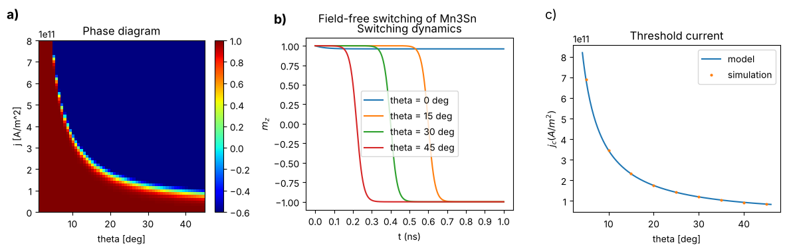
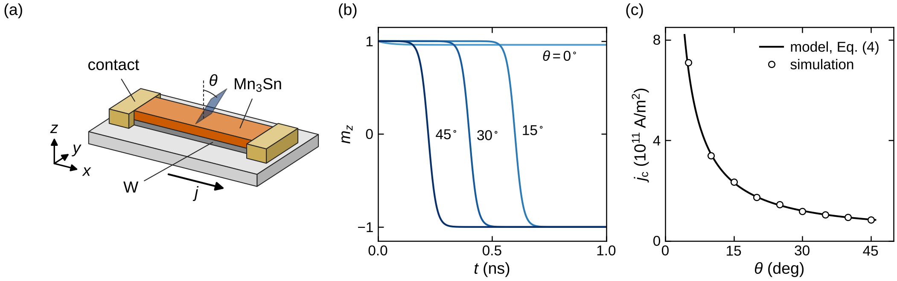

# complete-paper

[](https://github.com/gyuyoungpark/complete-paper/actions/workflows/tests.yml)
[](LICENSE)

[English](README.md) | [中文](README_zh.md) | [한국어](README_ko.md) | **日本語**

**研究成果から完成した論文へ。タイトル、要旨、図、結論が同じことを主張し、途中で数字も引用も作りません。**

complete-paper は、Claude Code、Codex など `SKILL.md` フォルダを読む agent で論文を書く研究者のための agent skill です。claim sheet から投稿準備まで、論文のすべてのパートを一つずつ扱います。各パートには規則とその根拠、そしてあなたの LaTeX ファイルを点検するスクリプトが付いています。

## できること

**図。** 図の初稿と、figures パートが作り直した同じ図です(架空のデータ)。初稿には、パネルごとのタイトル、虹色のカラーマップ、曲線に重なった凡例、二つの意味を持つ一つの色、二通りに書かれた単位があり、`fig_lint.py` はそれを一つずつ挙げます。作り直した図は一つのスタイル表から印刷時の幅で描き、模式図もコードで描いています。





**文章。** `parts/prose.md` を通す前と後の一段落です(架空の例)。単語を置き換えるのではなく、各文が何を主張しているのかを問うことで機械的な文体を取り除きます。

> *前。* It is worth noting that noncollinear antiferromagnets have attracted considerable attention in recent years, playing a pivotal role in next-generation spintronics. In this work, we performed a comprehensive investigation of the switching dynamics, which may potentially suggest a novel mechanism, highlighting the remarkable potential of tilted films. Overall, these findings pave the way for future memory applications.

> *後。* Switching a noncollinear antiferromagnet by current has so far required a magnetic field [A, B]. We simulated the reversal in films whose kagome plane is tilted, and found that the tilt replaces the field. The current alone sets the final state.

**点検。** 欠陥を仕込んだ短い架空の letter 原稿に対する audit レポートの一部です。

```
$ cd tests/fixtures/flawed
$ python ../../../skills/complete-paper/scripts/audit.py main.tex
...
- main.tex:51: a to-do mark is left in the text: "\textcolor{red}{\textbf{[TODO: data for the thick-film case]}}"
- Abstract: quotes 45, which the rest of the text does not contain: the abstract may give no number that the body lacks
...
  main.tex:52  c: cited 1 time(s), but no such entry
  main.tex:44: Fig. 3 is never cited in the text
  text: Figs are first cited in the order 2, 1: number them in the order of first citation
  CRITICAL main.tex:8             question mark in the title; rewrite as a statement or an indirect question
...
- part checks that fail: equations, citations, references
```

## インストール

**skill に対応した agent**(Claude Code、Codex、Cursor など)では、[skills CLI](https://github.com/vercel-labs/skills) を使います。

```bash
npx skills add gyuyoungpark/complete-paper
```

`-g` を付けると、現在のプロジェクトだけでなく、すべてのプロジェクトで使えるようにインストールします。

**Claude Code プラグイン**としては次のとおりです。

```
/plugin marketplace add gyuyoungpark/complete-paper
/plugin install complete-paper@complete-paper
```

プラグインとして入れた場合は `/complete-paper:complete-paper`、skills CLI で入れた場合は `/complete-paper` で呼び出します。

**Claude アプリ**では、[Releases](https://github.com/gyuyoungpark/complete-paper/releases) から `complete-paper.skill` をダウンロードし、アプリの skill 設定からアップロードします。

**更新**: skills CLI で入れた場合は `npx skills update` を実行します。プラグインとして入れた場合は `/plugin marketplace update complete-paper` を実行するか、`/plugin` でこの marketplace の自動更新を有効にします。Claude アプリでは、新しい release の `complete-paper.skill` をアップロードし直します。

必要なもの: Python 3.9 以上。図のスクリプトには matplotlib と numpy が必要です。`ref_check.py --online` にはネットワーク接続が必要です。`submit_check.py` は、インストールされていれば `pdflatex` と poppler のツールを使います。スクリプトは LaTeX の原稿を読みます。Word の原稿は、`docx_to_tex.py` が作る LaTeX の読み取り用コピーで点検します。

## はじめて使う

原稿のあるフォルダで agent を開き、次のように頼みます。

```
complete-paper で main.tex を点検して。見つけた問題を報告するだけで、修正はしないで。
```

audit モードでは報告だけを行って原稿は直さず、どの指摘を直すかを尋ねます。最初の一歩に向いたほかの頼み方です。

- 「complete-paper でこの論文の brief を作って。」brief は、ほかのすべてのパートが書くときの拠り所になる claim sheet です。
- 「complete-paper で要旨を書いて。」
- 「complete-paper で参考文献をオンラインで点検して。」各項目を Crossref または arXiv の記録と照合します。

登録も API キーも要りません。skill は作業ファイルを原稿の隣の `paper-state/` フォルダに置くので、次のセッションでも前回止まったところから続けられます。

## ほかの skill との違い

- **論文全体で claim sheet は一つです。** `brief.md` に結果、対象の系、証拠の種類、論文が示していないことを記録します。タイトル、要旨、キャプション、結論はすべてこれを基に書かれるので、互いに食い違う主張はできず、図が示す以上のことも主張できません。
- **どの規則にも出典があります。** 各パートに根拠ファイルがあり、ジャーナルの規定、発表された研究、skill を作る過程で実際に測ったこと、skill 独自の選択を区別しています。研究の結論が食い違う場合はそう書きます。引用数の増加や採択は約束しません。
- **規則が実行できます。** 20 本のスクリプトが、確かめられることを確かめます。Crossref と arXiv で存在しない参考文献を探し、描画された図の中で重なったラベル、要旨にはあるが本文にない数字、どこからも引用されない補足図、文章を「整える」つもりで数字を変えてしまった編集を見つけます。欠陥を仕込んだ 200 件以上のケースでスクリプトを検証しています。
- **AI の利用に正直です。** prose パートは単語を置き換えるのではなく、各文が何を主張しているのかを問うことで機械的な文体を取り除きます。AI 検出ツールについては何も約束しません。submit パートは投稿先が求める AI 利用の申告文の下書きを作り、著者が確認します。

## 原則

三つの原則がすべての規則に優先します(`skills/complete-paper/SKILL.md`)。

1. **人のために書かれた論文。** 読みやすく、機械的な文体は最小限にします。
2. **データは最終的なもので、空欄は埋めません。** 主張に合わせて値を変えることはしません。空欄は著者が埋めるまで、目に見える TODO 印として残します。
3. **用語を作りません。** 分野ですでに使われている言葉を使います。新しい名前は、新しい対象にどうしても必要なときだけ、著者の同意を得て使います。

すべてのパートに共通する規則もここから来ています。論文は自分の結果を主張するための文章であり、限界は Results の中で一つずつ一度だけ述べます。この研究で行ったことは "we" と能動態の動詞で書きます。段落は目的から始め、図・表・数式は論旨の順に番号を付け、本文ではコロンとセミコロンを使いません。すべての数字は出典までさかのぼって確かめます。

## 構成

skill は入口のファイル一つと 20 のパートからなり、一度に一つのパートだけを読みます。

| 段階 | パート |
|---|---|
| A. 基礎 | brief, venue, outline, notation |
| B. 本文 | equations, figures, tables, captions, methods, results, discussion, conclusion, intro, abstract, title |
| C. 前付けと後付け | bibliography, supplement |
| D. 仕上げ | prose, audit, submit |

順序は書く順序です。まとめの役割を持つパート(結論、序論、要旨、タイトル)は、それがまとめるパートの後に来ます。各パートの状態ファイルとスクリプトを載せた完全な表は `SKILL.md` にあります。

## スクリプト

すべて `skills/complete-paper/scripts/` にあり、一覧はそのフォルダの `README.md` にあります。文章用の 17 本は標準ライブラリだけを使い、図用の 3 本には matplotlib と numpy が必要です。

| スクリプト | 確かめること |
|---|---|
| `brief_check.py` | claim sheet |
| `ref_check.py`, `verify_refs.py` | すべての引用に項目があるか、`--online` を付ければすべての項目が実在の記録と一致するか(`verify_refs.py` は以前の小さな版) |
| `fig_style.py`, `schematic3d.py`, `fig_lint.py` | 論文ごとに一つの図の様式、コードで描く模式図、描画された図の重なり、図どうしでの色の意味、配置、文字の大きさ |
| `supp_check.py` | 補足資料。本文からの呼び出し、引用されていない項目、本文に対する分量、実はデータである項目 |
| `cite_order.py`, `eq_refs.py`, `table_check.py`, `caption_check.py` | 図、表、パネル、数式、キャプション |
| `methods_check.py` | 原稿と照らし合わせて埋める再現性のチェックリスト |
| `abstract_stats.py`, `overlap_check.py` | 要旨の分量の上限、結論と要旨・序論の重複 |
| `prose_lint.py` | 文の分布、機械的な文体のパターン、編集の見張り |
| `audit_tex.py`, `reverse_outline.py` | 執筆規則(Results 以外での限界の記述、態、句読点、ニーズとして書いた gap、違いとして書いた先行研究、番号の順序)と、すべての段落の最初の文 |
| `audit.py` | 最終ファイルに上記すべてと相互の照合をかけ、一つの報告にまとめる |
| `submit_check.py` | 足りないファイルと余分なファイル、コメント、行番号、匿名性、arXiv の規則。きれいな複製を作る |

「文体だけ」の編集が内容に触れたとき、`prose_lint.py` の編集の見張りはこう報告します。

```
$ python scripts/prose_lint.py --compare before.tex after.tex

CHANGED numbers
  only before: 300
  only after:  310

CHANGED citation keys
  only before: B

CHANGED formulas
  only before: $0.22\,\mathrm{ns}$
  only after:  $0.25\,\mathrm{ns}$

hedges: 2 before, 0 after: fewer hedges; check that no claim became stronger

the edit changed protected content: restore it, or have the author confirm each change
```

## テストの実行

```
python -m unittest discover -s tests                          # 以下すべてを skill の複製で
python skills/complete-paper/evals/figures/lint_cases.py      # 82 件(matplotlib が必要)
python skills/complete-paper/evals/supplement/supp_cases.py   # 52 件
python skills/complete-paper/evals/text/cases.py              # 41 件
python skills/complete-paper/evals/finish/cases.py            # 25 件
claude plugin eval . --runs 1 --no-publish --judge-model sonnet   # evals/ の agent レベルのケース(evals/README.md を参照)
```

`CP_NETWORK=1` を付けるとネットワークのテストも含まれます。スクリプトのケースは、小さな原稿や図に欠陥を一つ仕込み、出なければならない結果と出てはならない結果を書いておくものです。図のケースは例の図を描き直すので、複製の上で実行してください。`evals/` の agent レベルのケースは、Claude Code のセッションでプラグインを有効にした場合と無効にした場合の両方で skill を動かし、その振る舞いを採点します。

## 何を試し、何をまだ試していないか

スクリプトは欠陥を仕込んだケースをすべて通ります。`supp_check.py` は arXiv の原稿 4 本で、文章・監査・投稿のチェックは 2 本で動かしました。そこで出会った誤った報告はすべて直し、根拠ファイルに記録しています。その後、skill 全体を未発表のスピントロニクスの原稿 1 本に、監査と修正のモードで一度通しました。この実行で 4 本のスクリプトの誤報と見落としが見つかり、すべて直してテストで守っています(`CHANGELOG.md`)。agent レベルの 5 件のケース(`evals/README.md`)では、skill を使ったセッションが 4 件、使わないセッションが 3 件を通りました。差が出たのはタイトルのケースで、5 件目は既定の採点モデルの問題で両方とも通りませんでした。この skill で論文を結果から採択まで仕上げたことはまだなく、方法のチェックリストはほかの分野よりも磁性とスピントロニクスの慣習を多く反映しています。実際の原稿で起きた失敗の報告がいちばん役に立ちます。

## フォルダ構成

```
skills/complete-paper/
  SKILL.md        入口: パート、順序、状態ファイル、どこでも守る規則
  parts/          論文のパートごとに規則のファイルが一つ
  references/     各パートの規則の根拠
  scripts/        チェックのスクリプト
  assets/         intake と保存された既定値の書式
  examples/       架空の例
  evals/          スクリプト用の欠陥ケース
evals/            claude plugin eval 用の agent レベルのケース
tests/            スクリプトの単体テスト
tools/            バージョン、リリース、パッケージの補助ツール
archive/          skill から外した、インストールされないパート
```

## 貢献

issue と pull request を歓迎します。特に歓迎するのは次のようなものです。実際の原稿でスクリプトが誤ったことを報告した、あるいは本当の問題を見落とした例。変わったジャーナルの規定。これらのパートが慣習を誤って扱っている分野。新しい規則には出典を付けるか、"own rule" と書いてください。新しいバージョンを出す手順は `RELEASING.md` にあります。

## 開発者

complete-paper は **Gyuyoung Park** が開発しています。

- ホームページ: <https://gyuyoungpark.github.io/>
- GitHub: <https://github.com/gyuyoungpark>
- ResearchGate: <https://www.researchgate.net/profile/Gyuyoung-Park-2>

## ライセンス

MIT。`LICENSE` を参照してください。
