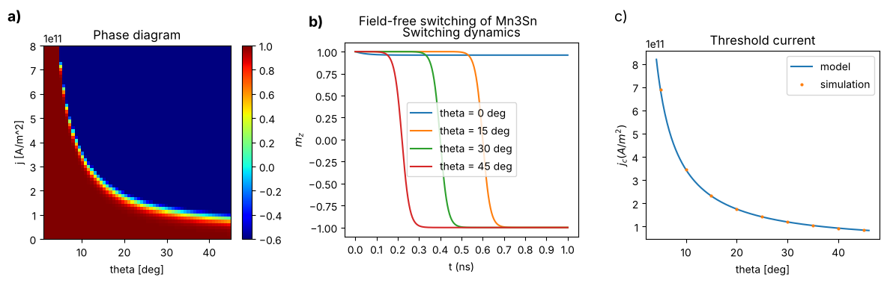
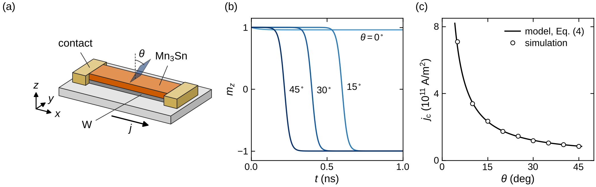

# complete-paper

[](https://github.com/gyuyoungpark/complete-paper/actions/workflows/tests.yml)
[](LICENSE)

[English](README.md) | [中文](README_zh.md) | **한국어** | [日本語](README_ja.md)

**연구 결과에서 완성된 논문까지. 제목, 초록, 그림, 결론이 같은 것을 주장하고, 그 과정에서 숫자도 인용도 지어내지 않습니다.**

complete-paper는 Claude Code, Codex 등 `SKILL.md` 폴더를 읽는 agent로 논문을 쓰는 연구자를 위한 agent skill입니다. claim sheet부터 투고 준비까지 논문의 모든 부분을 한 번에 한 부분씩 다룹니다. 부분마다 규칙과 그 근거, 그리고 여러분의 LaTeX 파일을 점검하는 script가 있습니다.

## 하는 일

**그림.** 초안 그림과, figures 부분이 같은 그림을 다시 만든 결과입니다(지어낸 데이터). 초안에는 패널마다 붙은 제목, 무지개 컬러맵, 곡선 위에 놓인 범례, 두 가지 뜻으로 쓰인 한 색, 두 방식으로 적은 단위가 있고, `fig_lint.py`는 이것들을 하나하나 짚어 냅니다. 다시 만든 그림은 하나의 style 표에서 인쇄될 폭 그대로 그렸고, 모식도도 코드로 그렸습니다.





**문장.** `parts/prose.md`를 거치기 전과 후의 한 문단입니다(지어낸 예시). 단어를 바꿔서가 아니라 문장마다 무엇을 주장하는지 물어서 기계 문체를 걷어 냅니다.

> *전.* It is worth noting that noncollinear antiferromagnets have attracted considerable attention in recent years, playing a pivotal role in next-generation spintronics. In this work, we performed a comprehensive investigation of the switching dynamics, which may potentially suggest a novel mechanism, highlighting the remarkable potential of tilted films. Overall, these findings pave the way for future memory applications.

> *후.* Switching a noncollinear antiferromagnet by current has so far required a magnetic field [A, B]. We simulated the reversal in films whose kagome plane is tilted, and found that the tilt replaces the field. The current alone sets the final state.

**점검.** 결함을 심어 둔 짧은 가상의 letter 원고에 대한 audit 보고서의 일부입니다.

```
$ cd tests/fixtures/flawed
$ python ../../../skills/complete-paper/scripts/audit.py main.tex
...
- main.tex:51: a to-do mark is left in the text: "\textcolor{red}{\textbf{[TODO: data for the thick-film case]}}"
- Abstract: quotes 45, which the rest of the text does not contain: the abstract may give no number that the body lacks
...
  main.tex:52  c: cited 1 time(s), but no such entry
  main.tex:44: Fig. 3 is never cited in the text
  text: Figs are first cited in the order 2, 1: number them in the order of first citation
  CRITICAL main.tex:8             question mark in the title; rewrite as a statement or an indirect question
...
- part checks that fail: equations, citations, references
```

## 설치

**Skill을 지원하는 agent**(Claude Code, Codex, Cursor 등)에서는 [skills CLI](https://github.com/vercel-labs/skills)로 설치합니다.

```bash
npx skills add gyuyoungpark/complete-paper
```

`-g`를 붙이면 현재 프로젝트만이 아니라 모든 프로젝트에서 쓸 수 있게 설치합니다.

**Claude Code plugin**으로는 다음과 같습니다.

```
/plugin marketplace add gyuyoungpark/complete-paper
/plugin install complete-paper@complete-paper
```

Plugin으로 설치하면 `/complete-paper:complete-paper`, skills CLI로 설치하면 `/complete-paper`로 부릅니다.

**Claude 앱**에서는 [Releases](https://github.com/gyuyoungpark/complete-paper/releases)에서 `complete-paper.skill`을 내려받아 앱의 skill 설정에서 올립니다.

**업데이트**: skills CLI로 설치했다면 `npx skills update`를 실행합니다. Plugin으로 설치했다면 `/plugin marketplace update complete-paper`를 실행하거나, `/plugin`에서 이 marketplace의 자동 업데이트를 켭니다. Claude 앱에서는 새 release의 `complete-paper.skill`을 다시 올립니다.

필요한 것: Python 3.9 이상. 그림 script에는 matplotlib과 numpy가 필요합니다. `ref_check.py --online`은 인터넷 연결이 필요합니다. `submit_check.py`는 설치되어 있으면 `pdflatex`와 poppler 도구를 씁니다. Script는 LaTeX 원고를 읽습니다. Word 원고는 `docx_to_tex.py`가 만든 LaTeX 읽기용 사본으로 점검합니다.

## 처음 써 보기

원고가 있는 폴더에서 agent를 열고 이렇게 요청합니다.

```
complete-paper로 main.tex를 점검해 줘. 찾은 문제만 알려 주고 고치지는 마.
```

Audit 모드에서는 보고만 하고 원고를 고치지 않으며, 어떤 항목을 고칠지 묻습니다. 처음 해 볼 만한 다른 요청입니다.

- "complete-paper로 이 논문의 brief부터 만들어 줘." Brief는 다른 모든 부분이 보고 쓰는 claim sheet입니다.
- "complete-paper로 초록을 써 줘."
- "complete-paper로 참고문헌을 온라인으로 점검해 줘." 참고문헌 항목마다 Crossref나 arXiv의 기록과 대조합니다.

가입도 API 키도 필요 없습니다. Skill은 작업 파일을 원고 옆의 `paper-state/` 폴더에 두므로, 다음 세션에서도 지난번에 멈춘 곳에서 이어 갑니다.

## 다른 skill과 다른 점

- **논문 전체에 claim sheet가 하나입니다.** `brief.md`에 결과, 시스템, 증거의 종류, 논문이 보이지 않은 것을 적어 둡니다. 제목, 초록, caption, 결론이 모두 이것을 보고 쓰이므로 서로 다른 주장을 할 수 없고, 그림이 보인 것보다 많이 주장할 수도 없습니다.
- **모든 규칙에 출처가 있습니다.** 부분마다 근거 파일이 있어 저널 규정, 발표된 연구, skill을 만들며 직접 측정한 것, skill 자체의 선택을 구분합니다. 연구 결과가 서로 엇갈리면 그렇다고 적습니다. 인용 수 증가나 게재를 약속하지 않습니다.
- **규칙이 실행됩니다.** Script 20개가 점검할 수 있는 것을 점검합니다. Crossref와 arXiv로 존재하지 않는 참고문헌을 찾고, 그려진 그림 안의 겹친 라벨, 초록에는 있지만 본문에는 없는 숫자, 아무도 인용하지 않는 보충 그림, 문장을 "다듬다가" 숫자를 바꾼 편집을 찾습니다. 결함을 심은 사례 200여 개로 이 script들을 시험합니다.
- **AI 사용에 정직합니다.** Prose 부분은 단어를 바꾸는 대신 문장마다 무엇을 주장하는지 물어서 기계 문체를 없애고, AI 탐지기에 대해서는 아무것도 약속하지 않습니다. Submit 부분은 저널이 요구하는 AI 사용 고지의 초안을 만들고, 저자가 확인합니다.

## 원칙

모든 규칙보다 세 원칙이 앞섭니다(`skills/complete-paper/SKILL.md`).

1. **사람을 위해 쓴 논문.** 읽기 쉽고, 기계 문체는 최소로 둡니다.
2. **데이터는 최종이며, 빈 값은 채우지 않습니다.** 메시지를 위해 값을 바꾸지 않습니다. 빈칸은 저자가 채울 때까지 눈에 보이는 TODO 표시로 남깁니다.
3. **용어를 지어내지 않습니다.** 학계가 이미 쓰는 말을 씁니다. 새 이름은 새로운 대상에 꼭 필요할 때만, 저자의 동의를 받아 씁니다.

모든 부분에 걸리는 규칙도 여기서 나옵니다. 논문은 자기 결과를 설득하는 글이고, 한계는 Results에서 하나씩 한 번만 말합니다. 우리가 한 일은 "we"와 능동 동사로 씁니다. 문단은 목적으로 시작하고, 그림, 표, 수식은 논리 순서대로 번호를 매기며, 본문에는 콜론과 세미콜론을 쓰지 않습니다. 모든 숫자는 출처까지 거슬러 올라가 확인합니다.

## 구성

Skill은 진입 파일 하나와 부분 20개로 되어 있고, 한 번에 한 부분만 읽습니다.

| 단계 | 부분 |
|---|---|
| A. 기반 | brief, venue, outline, notation |
| B. 본문 | equations, figures, tables, captions, methods, results, discussion, conclusion, intro, abstract, title |
| C. 앞뒤 부속 | bibliography, supplement |
| D. 마무리 | prose, audit, submit |

순서는 쓰는 순서입니다. 요약하는 부분(결론, 서론, 초록, 제목)은 그것이 요약하는 부분 뒤에 옵니다. 부분마다의 state 파일과 script를 담은 전체 표는 `SKILL.md`에 있습니다.

## Script

모두 `skills/complete-paper/scripts/`에 있고, 목록은 그 폴더의 `README.md`에 있습니다. 문서용 17개는 표준 라이브러리만 쓰고, 그림용 3개는 matplotlib과 numpy가 필요합니다.

| Script | 점검하는 것 |
|---|---|
| `brief_check.py` | claim sheet |
| `ref_check.py`, `verify_refs.py` | 모든 인용에 항목이 있는지, `--online`을 주면 모든 항목이 실제 기록과 맞는지(`verify_refs.py`는 이전의 작은 판) |
| `fig_style.py`, `schematic3d.py`, `fig_lint.py` | 논문당 하나의 그림 양식, 코드로 그리는 schematic, 그려진 그림의 겹침, 그림 사이 색의 뜻, 정렬, 글자 크기 |
| `supp_check.py` | 보충 자료. 본문의 호출, 인용되지 않은 항목, 본문 대비 크기, 사실은 데이터인 항목 |
| `cite_order.py`, `eq_refs.py`, `table_check.py`, `caption_check.py` | 그림, 표, 패널, 수식, caption |
| `methods_check.py` | 원고와 대조해 채우는 재현성 점검표 |
| `abstract_stats.py`, `overlap_check.py` | 초록의 분량 한도, 결론과 초록·서론의 중복 |
| `prose_lint.py` | 문장 분포, 기계 문체 유형, 편집 감시 |
| `audit_tex.py`, `reverse_outline.py` | 글쓰기 규칙(Results 밖의 한계 문장, 태, 문장 부호, 필요로 쓴 gap, 차이로 쓴 선행 연구, 번호 순서)과 모든 문단의 첫 문장 |
| `audit.py` | 최종 파일에 위의 모든 점검과 교차 점검을 돌려 보고서 하나로 묶음 |
| `submit_check.py` | 빠진 파일과 남는 파일, 주석, 줄 번호, 익명성, arXiv 규칙. 깨끗한 사본을 만듦 |

"문체만 고친" 편집이 내용을 건드리면 `prose_lint.py`의 편집 감시는 이렇게 알립니다.

```
$ python scripts/prose_lint.py --compare before.tex after.tex

CHANGED numbers
  only before: 300
  only after:  310

CHANGED citation keys
  only before: B

CHANGED formulas
  only before: $0.22\,\mathrm{ns}$
  only after:  $0.25\,\mathrm{ns}$

hedges: 2 before, 0 after: fewer hedges; check that no claim became stronger

the edit changed protected content: restore it, or have the author confirm each change
```

## 시험

```
python -m unittest discover -s tests                          # 아래 전부를 skill의 사본에서
python skills/complete-paper/evals/figures/lint_cases.py      # 82개 (matplotlib 필요)
python skills/complete-paper/evals/supplement/supp_cases.py   # 52개
python skills/complete-paper/evals/text/cases.py              # 41개
python skills/complete-paper/evals/finish/cases.py            # 25개
claude plugin eval . --runs 1 --no-publish --judge-model sonnet   # evals/의 agent 수준 사례 (evals/README.md 참고)
```

`CP_NETWORK=1`을 주면 인터넷 시험도 함께 돕니다. Script 사례는 작은 원고나 그림에 결함을 하나 심고, 반드시 나와야 할 결과와 나오면 안 되는 결과를 적어 둡니다. 그림 사례는 예시 그림을 다시 그리므로 사본에서 돌리세요. `evals/`의 agent 수준 사례는 Claude Code 세션에서 plugin을 켠 상태와 끈 상태로 skill을 돌리고, 그 행동에 점수를 매깁니다.

## 시험한 것과 아직 시험하지 않은 것

Script들은 결함을 심은 사례를 모두 통과합니다. `supp_check.py`는 arXiv 원고 네 편에, 문서·감사·투고 점검은 두 편에 돌려 보았고, 그때 만난 잘못된 보고는 모두 고쳐 근거 파일에 기록했습니다. 그 뒤 skill 전체를 아직 발표되지 않은 스핀트로닉스 원고 한 편에 감사·수정 모드로 한 차례 돌렸습니다. 이 실행에서 script 네 개의 잘못된 보고와 놓친 것을 찾았고, 모두 고쳐 시험으로 지키고 있습니다(`CHANGELOG.md`). Agent 수준 사례 다섯 개(`evals/README.md`)에서는 skill을 쓴 세션이 네 개, 쓰지 않은 세션이 세 개를 통과했습니다. 차이는 제목 사례에서 났고, 다섯째 사례는 기본 채점 모델의 문제로 양쪽 모두 통과하지 못했습니다. 아직 이 skill로 논문 한 편을 결과에서 게재까지 끝낸 적은 없고, 방법 점검표는 다른 분야보다 자성과 스핀트로닉스의 관례를 더 많이 반영합니다. 실제 원고에서 만난 실패 보고가 가장 큰 도움이 됩니다.

## 폴더 구조

```
skills/complete-paper/
  SKILL.md        진입점: 부분, 순서, state 파일, 어디서나 지키는 규칙
  parts/          논문의 부분마다 규칙 파일 하나
  references/     각 부분 규칙의 근거
  scripts/        점검 script
  assets/         intake와 저장된 기본값의 양식
  examples/       지어낸 예시
  evals/          script용 결함 사례
evals/            claude plugin eval용 agent 수준 사례
tests/            script의 단위 시험
tools/            버전, 릴리스, 패키지 도구
archive/          skill에서 빼낸, 설치되지 않는 부분
```

## 기여

Issue와 pull request를 환영합니다. 특히 다음이 반갑습니다. 실제 원고에서 script가 틀린 것을 보고했거나 실제 문제를 놓친 사례, 바뀐 저널 규정, 이 부분들이 관례를 잘못 다루는 분야. 새 규칙에는 출처를 달거나 "own rule"이라고 적어 주세요. 새 버전을 내는 절차는 `RELEASING.md`에 있습니다.

## 개발자

complete-paper는 **Gyuyoung Park**이 개발했습니다.

- 홈페이지: <https://gyuyoungpark.github.io/>
- GitHub: <https://github.com/gyuyoungpark>
- ResearchGate: <https://www.researchgate.net/profile/Gyuyoung-Park-2>

## 라이선스

MIT. `LICENSE`를 보세요.
