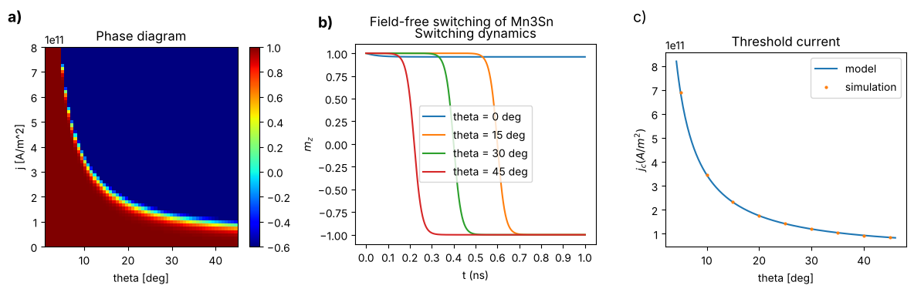
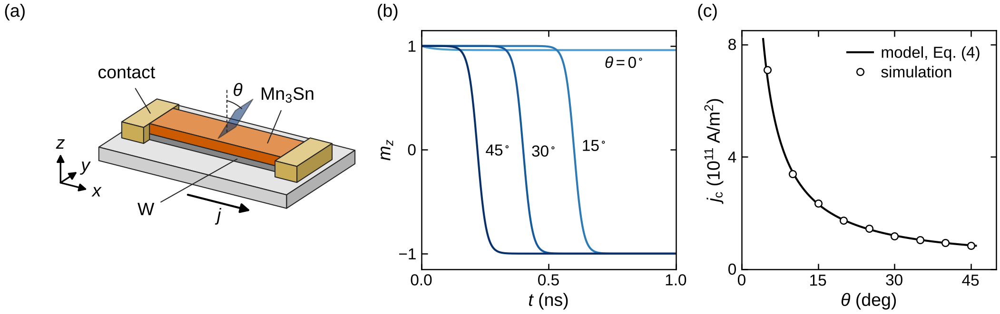

# complete-paper

[](https://github.com/gyuyoungpark/complete-paper/actions/workflows/tests.yml)
[](LICENSE)

[English](README.md) | **中文** | [한국어](README_ko.md) | [日本語](README_ja.md)

**从研究结果到完成的论文：标题、摘要、图和结论主张同一件事，途中不编造任何数字或引用。**

complete-paper 是一个 agent skill，面向使用 Claude Code、Codex 或其他读取 `SKILL.md` 文件夹的 agent 写论文的研究者。它从 claim sheet 到投稿材料，一次一个部分地覆盖论文的每一个部分。每个部分都附有规则、规则的依据，以及一个检查你的 LaTeX 文件的脚本。

## 它做什么

**图。** 一张初稿图，以及 figures 部分重新制作的同一张图（虚构数据）。初稿的每个面板都有标题，用了彩虹色图，图例压在曲线上，同一种颜色有两种含义，单位有两种写法。`fig_lint.py` 会逐一列出这些问题。重新制作的图依据一张样式表按印刷宽度绘制，示意图也由代码绘制。





**文字。** 经过 `parts/prose.md` 前后的一段文字（虚构示例）。去除机器腔调靠的不是替换词语，而是追问每个句子究竟主张了什么。

> *修改前。* It is worth noting that noncollinear antiferromagnets have attracted considerable attention in recent years, playing a pivotal role in next-generation spintronics. In this work, we performed a comprehensive investigation of the switching dynamics, which may potentially suggest a novel mechanism, highlighting the remarkable potential of tilted films. Overall, these findings pave the way for future memory applications.

> *修改后。* Switching a noncollinear antiferromagnet by current has so far required a magnetic field [A, B]. We simulated the reversal in films whose kagome plane is tilted, and found that the tilt replaces the field. The current alone sets the final state.

**检查。** 对一篇植入了缺陷的虚构短文（letter）运行 audit 得到的报告节选：

```
$ cd tests/fixtures/flawed
$ python ../../../skills/complete-paper/scripts/audit.py main.tex
...
- main.tex:51: a to-do mark is left in the text: "\textcolor{red}{\textbf{[TODO: data for the thick-film case]}}"
- Abstract: quotes 45, which the rest of the text does not contain: the abstract may give no number that the body lacks
...
  main.tex:52  c: cited 1 time(s), but no such entry
  main.tex:44: Fig. 3 is never cited in the text
  text: Figs are first cited in the order 2, 1: number them in the order of first citation
  CRITICAL main.tex:8             question mark in the title; rewrite as a statement or an indirect question
...
- part checks that fail: equations, citations, references
```

## 安装

**支持 skill 的 agent**（Claude Code、Codex、Cursor 等），使用 [skills CLI](https://github.com/vercel-labs/skills):

```bash
npx skills add gyuyoungpark/complete-paper
```

加上 `-g` 可为你的所有项目安装，而不只是当前项目。

**Claude Code 插件**：

```
/plugin marketplace add gyuyoungpark/complete-paper
/plugin install complete-paper@complete-paper
```

作为插件安装时，调用名为 `/complete-paper:complete-paper`；用 skills CLI 安装时为 `/complete-paper`。

**Claude 应用**：从 [Releases](https://github.com/gyuyoungpark/complete-paper/releases) 下载 `complete-paper.skill`，在应用的 skill 设置中上传。

**更新**：用 skills CLI 安装的，运行 `npx skills update`。作为插件安装的，运行 `/plugin marketplace update complete-paper`，或在 `/plugin` 中为该 marketplace 开启自动更新。在 Claude 应用中，上传新版本 release 中的 `complete-paper.skill`。

环境要求：Python 3.9 或更高版本。绘图脚本需要 matplotlib 和 numpy。`ref_check.py --online` 需要联网。`submit_check.py` 在已安装时会使用 `pdflatex` 和 poppler 工具。脚本读取 LaTeX 源文件；Word 稿件先由 `docx_to_tex.py` 转成供检查用的 LaTeX 副本。

## 第一次使用

在稿件所在的文件夹中打开 agent，然后输入：

```
用 complete-paper 检查 main.tex。只报告发现的问题，不要修改。
```

在 audit 模式下，skill 只报告、从不修改，并会询问要修正哪些问题。其他适合作为第一步的请求：

- “用 complete-paper 为这篇论文建立 brief。” brief 是其他所有部分写作时依据的 claim sheet。
- “用 complete-paper 写摘要。”
- “用 complete-paper 在线检查我的参考文献。” 每条文献都会与 Crossref 或 arXiv 的记录核对。

无需注册，也不需要 API 密钥。skill 把工作文件保存在稿件旁的 `paper-state/` 文件夹中，下一次会话可以从上次停下的地方继续。

## 与其他 skill 的不同

- **整篇论文只有一份 claim sheet。** `brief.md` 记录结果、研究体系、证据类型，以及论文没有展示的内容。标题、摘要、图注和结论都依据它来写，因此它们不会各说各话，也不会声称多于图所展示的内容。
- **每条规则都注明来源。** 每个部分都有一个依据文件，区分期刊规定、已发表的研究、构建 skill 时实际测得的内容，以及本 skill 自己的选择。研究结论不一致时，文件会直接说明。本 skill 不承诺更多引用，也不承诺被接收。
- **规则可以运行。** 20 个脚本检查一切可以检查的内容：用 Crossref 和 arXiv 核对不存在的参考文献、渲染后图中重叠的标签、摘要里有而正文里没有的数字、没有被引用的补充图，以及在“润色”句子时改动了数字的编辑。200 多个植入缺陷的用例检验这些脚本。
- **对 AI 的使用保持诚实。** prose 部分不是靠替换词语，而是追问每个句子究竟主张了什么，以此去除机器腔调；它不对任何 AI 检测器作出承诺。submit 部分会按期刊要求起草 AI 使用声明，由作者确认。

## 原则

三条原则优先于所有规则（`skills/complete-paper/SKILL.md`）：

1. **为人而写的论文。** 易读，尽量减少机器腔调。
2. **数据是最终的，空白绝不填补。** 不为迎合论点而改动任何数值。空白处保留醒目的 TODO 标记，直到作者亲自补上。
3. **不自创术语。** 使用领域内已有的词语。只有当新事物确实需要新名称时才命名，并须经作者同意。

适用于所有部分的规则都由此而来。论文为自己的结果立论，每项局限只在 Results 中陈述一次。本研究做的事用 "we" 加主动动词来写。段落先说目的，图、表、公式按论证顺序编号，正文中不用冒号和分号。每个数字都能追溯到它的来源。

## 组成部分

skill 由一个入口文件和 20 个部分组成，每次只读取其中一个。

| 阶段 | 部分 |
|---|---|
| A. 基础 | brief, venue, outline, notation |
| B. 正文 | equations, figures, tables, captions, methods, results, discussion, conclusion, intro, abstract, title |
| C. 前后附属内容 | bibliography, supplement |
| D. 收尾 | prose, audit, submit |

顺序就是写作的顺序：起总结作用的部分（结论、引言、摘要、标题）排在它们所总结的部分之后。`SKILL.md` 中有完整的表格，列出每个部分的状态文件和脚本。

## 脚本

全部位于 `skills/complete-paper/scripts/`，清单见其中的 `README.md`。用于文本的 17 个脚本只依赖标准库；用于绘图的 3 个脚本需要 matplotlib 和 numpy。

| 脚本 | 检查内容 |
|---|---|
| `brief_check.py` | claim sheet |
| `ref_check.py`, `verify_refs.py` | 每个引用都有条目；加 `--online` 时，每个条目都与真实记录一致（`verify_refs.py` 是较早、较小的版本） |
| `fig_style.py`, `schematic3d.py`, `fig_lint.py` | 每篇论文统一一种图风格，用代码绘制示意图，并检查渲染后的图：重叠、各图之间颜色含义是否一致、对齐和字号 |
| `supp_check.py` | 补充材料：正文中的调用、未被引用的项目、相对正文的篇幅、实为数据的项目 |
| `cite_order.py`, `eq_refs.py`, `table_check.py`, `caption_check.py` | 图、表、子图、公式和图注 |
| `methods_check.py` | 对照稿件填写的可重复性清单 |
| `abstract_stats.py`, `overlap_check.py` | 摘要是否超出限制；结论是否与摘要、引言重复 |
| `prose_lint.py` | 句子概况、机器腔调模式，以及编辑守卫 |
| `audit_tex.py`, `reverse_outline.py` | 写作规则（Results 以外的局限陈述、语态、标点、作为需求的 gap、以差异描述的前人工作、编号顺序），以及每段的第一句 |
| `audit.py` | 在最终文件上运行以上全部检查，外加交叉核对，汇成一份报告 |
| `submit_check.py` | 缺失与多余的文件、注释、行号、匿名性、arXiv 规则；生成干净的副本 |

当一次“文字上的”修改触及内容时，`prose_lint.py` 的编辑守卫会这样报告：

```
$ python scripts/prose_lint.py --compare before.tex after.tex

CHANGED numbers
  only before: 300
  only after:  310

CHANGED citation keys
  only before: B

CHANGED formulas
  only before: $0.22\,\mathrm{ns}$
  only after:  $0.25\,\mathrm{ns}$

hedges: 2 before, 0 after: fewer hedges; check that no claim became stronger

the edit changed protected content: restore it, or have the author confirm each change
```

## 运行测试

```
python -m unittest discover -s tests                          # 以下全部,在 skill 的副本上运行
python skills/complete-paper/evals/figures/lint_cases.py      # 82 个用例(需要 matplotlib)
python skills/complete-paper/evals/supplement/supp_cases.py   # 52 个用例
python skills/complete-paper/evals/text/cases.py              # 41 个用例
python skills/complete-paper/evals/finish/cases.py            # 25 个用例
claude plugin eval . --runs 1 --no-publish --judge-model sonnet   # evals/ 中的 agent 级用例(见 evals/README.md)
```

加上 `CP_NETWORK=1` 可包含联网测试。每个脚本用例都在一份小稿件或一张图中植入一个缺陷，并写明哪些结果必须出现、哪些不得出现。绘图用例会重新绘制示例图，请在副本上运行。`evals/` 中的 agent 级用例在 Claude Code 会话中分别开启和关闭插件运行 skill，并对其行为打分。

## 已经测试过什么、还没有测试过什么

脚本通过了各自的植入缺陷用例。`supp_check.py` 还在四篇 arXiv 稿件上运行过，文本、核查和投稿检查在两篇上运行过；其中遇到的每一个误报都已修正，并记录在依据文件中。随后整个 skill 以核查加修改的模式，在一篇未发表的自旋电子学稿件上完整运行过一次。那次运行发现了四个脚本中的误报和漏报，均已修正并有测试覆盖（`CHANGELOG.md`）。在五个 agent 级用例中（`evals/README.md`），使用 skill 的会话通过了四个，不使用的通过了三个；差别出现在标题用例上，第五个用例因默认评审模型的问题在两种情况下都未通过。本 skill 还没有被用来把一篇论文从结果一路带到接收，方法部分的清单也更多反映磁学和自旋电子学的习惯。在真实稿件上发现的失败报告是最有价值的贡献。

## 目录结构

```
skills/complete-paper/
  SKILL.md        路由:各部分、顺序、状态文件、处处适用的规则
  parts/          论文每个部分一份规则文件
  references/     每个部分规则的依据
  scripts/        检查脚本
  assets/         intake 和已保存默认值的表单
  examples/       虚构示例
  evals/          脚本的植入缺陷用例
evals/            claude plugin eval 的 agent 级用例
tests/            脚本的单元测试
tools/            版本、发布与打包工具
archive/          从 skill 中移出、不会被安装的部分
```

## 参与贡献

欢迎提交 issue 和 pull request，尤其是：某个脚本在真实稿件上报告了错误的内容或漏掉了真实问题；某条期刊规定已经改变；某个领域的惯例被这些部分处理错了。新规则需要注明来源，或写明"own rule"。发布新版本的步骤见 `RELEASING.md`。

## 作者

complete-paper 由 **Gyuyoung Park** 开发。

- 主页：<https://gyuyoungpark.github.io/>
- GitHub:<https://github.com/gyuyoungpark>
- ResearchGate:<https://www.researchgate.net/profile/Gyuyoung-Park-2>

## 许可证

MIT。见 `LICENSE`。
